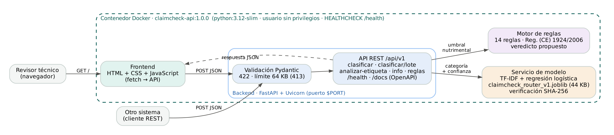

# ClaimCheck IA · Fase 2 — Solución desplegable en contenedor


**Gestión de proyectos de inteligencia artificial · Universidad Tecmilenio · Proyecto, Fase 2 (Ejecución)**
Autor: Brandon Gilberto Imanol Retana Fuentes (AL07175444) · Octubre de 2026

ClaimCheck IA preclasifica los *claims* de una etiqueta de alimentos para el organismo certificador ficticio
**CertiBajío, S.C.** (caso de negocio de la Fase 1). Esta fase entrega la solución técnica completa: un modelo
entrenado, una API REST, un frontend web y un motor de reglas, empaquetados en **un contenedor Docker**
listo para desplegarse en una plataforma PaaS.

> **La IA propone, el revisor decide.** El modelo enruta cada claim a su checklist y las reglas comparan la tabla
> nutrimental contra el Reg. (CE) 1924/2006; la decisión de certificación la toma el revisor técnico (ISO/IEC 17065).

| | |
|---|---|
| **Modelo** | TF-IDF (palabras + caracteres) + regresión logística · 44 KB · SHA-256 verificado al arrancar |
| **Macro-F1 en prueba** | **0.852** (169 claims) frente a 0.599 del mejor modelo zero-shot de la Actividad 4 |
| **Pruebas** | 84 automatizadas (pytest, dentro del build) + 50 de punta a punta contra el contenedor: **todas aprobadas** |
| **Latencia** | p95 de 44 ms en local (0.5 CPU) y 95 ms con los recursos del plan Free de Render (0.1 CPU) |
| **Memoria** | ~99 MB de los 512 MB del plan Free |

---

## 1. Arquitectura



| Componente | Tecnología | Archivo |
|---|---|---|
| Frontend (dinámico) | HTML + CSS + JavaScript (`fetch`) | `frontend/` |
| Backend / API REST | FastAPI + Uvicorn, validación con Pydantic | `app/main.py`, `app/esquemas.py` |
| Modelo | scikit-learn, serializado con joblib | `app/modelo.py`, `modelos/` |
| Reglas deterministas | 14 reglas del Anexo del Reg. (CE) 1924/2006 | `app/reglas.py` |
| Contenedor | Dockerfile de 3 etapas (base · test · runtime) | `Dockerfile`, `docker-compose.yml` |
| Integración continua | GitHub Actions | `.github/workflows/ci.yml` |
| Despliegue PaaS | Render (Blueprint) · alternativa Google Cloud Run | `render.yaml`, manual en `docs/` |

## 2. Inicio rápido (Docker)

Requisito: Docker Desktop (Windows/macOS) o Docker Engine (Linux). Instrucciones detalladas, con PowerShell y
solución de problemas, en **[INSTRUCCIONES_DOCKER.md](INSTRUCCIONES_DOCKER.md)**.

```bash
git clone https://github.com/BGIRF/BGIRF_Proyecto_Fase2_GPIA.git
cd BGIRF_Proyecto_Fase2_GPIA
docker build -t claimcheck-api:1.0.0 .          # corre las 84 pruebas; si una falla, no hay imagen
docker run -d --name claimcheck -p 8000:8000 claimcheck-api:1.0.0
```

Abre **http://localhost:8000** (frontend) y **http://localhost:8000/docs** (documentación interactiva de la API).
Alternativa con un solo comando: `docker compose up --build`.

Validación de punta a punta (solo necesita Python, sin instalar paquetes):

```bash
python scripts/validar_contenedor.py
```

## 3. API REST

| Método | Ruta | Uso |
|---|---|---|
| GET | `/health` | Salud del servicio y del modelo (lo usan el `HEALTHCHECK` y la PaaS) |
| GET | `/api/v1/info` | Versión, métricas, umbral τ y huella del modelo desplegado |
| GET | `/api/v1/reglas` | Las 14 reglas nutrimentales disponibles |
| POST | `/api/v1/clasificar` | Un claim → categoría, confianza, checklist y motivos para confirmar |
| POST | `/api/v1/clasificar/lote` | Hasta 50 claims en una llamada |
| POST | `/api/v1/analizar-etiqueta` | Etiqueta completa: enrutamiento + reglas con la tabla nutrimental |
| GET | `/docs`, `/openapi.json` | Contrato OpenAPI y Swagger UI |

```bash
curl -X POST http://localhost:8000/api/v1/analizar-etiqueta \
  -H "Content-Type: application/json" \
  -d '{"claims": ["Fuente de fibra", "Bajo en grasa", "Sin gluten"],
       "datos_nutrimentales": {"estado_fisico": "solido", "energia_kcal": 372, "grasa_g": 6.5, "fibra_g": 9.8}}'
```

Respuesta (resumida):

```json
{
  "resultados": [
    {"texto": "Fuente de fibra", "categoria": "NUTRIMENTAL", "confianza": 0.39,
     "checklist": "CL-NUT · Umbrales contra la tabla nutrimental", "requiere_confirmacion": false,
     "regla": {"regla_id": "R11", "veredicto_propuesto": "CUMPLE", "detalle": "9.8 g/100 g ≥ 3 g/100 g"}},
    {"texto": "Bajo en grasa", "categoria": "NUTRIMENTAL",
     "regla": {"regla_id": "R05", "veredicto_propuesto": "NO_CUMPLE", "detalle": "6.5 g/100 g > 3 g/100 g"}}
  ],
  "aviso": "La IA propone, el revisor decide: …"
}
```

`scripts/ejemplos_api.md` tiene los mismos ejemplos en PowerShell (`Invoke-RestMethod`).

## 4. Resultados

**Modelo** (`modelos/claimcheck_router_v1.json`, figuras en `resultados/figuras/`): entrenado con los 71 claims de
la partición `dev` del dataset de la Actividad 4 y medido con los mismos 169 claims de `test`.

| Métrica (test) | Fase 2 · supervisado | Mejor zero-shot (Act. 4) | Umbral de negocio |
|---|---|---|---|
| Macro-F1 | **0.852** | 0.599 (mDeBERTa-base) | ≥ 0.80 ✔ |
| Accuracy | 0.852 | 0.615 (XLM-R-large) | — |
| Recall de SALUD | 0.857 | 0.857 (mDeBERTa-base) | ≥ 0.90 ✘ |
| Latencia en CPU | 0.15 ms/claim (lote) | 377 ms/claim (MiniLM-L6) | ≤ 300 ms ✔ |

Con el umbral τ = 0.35 y la verificación cruzada modelo–regla, el 82 % de los claims se enruta sin confirmación con
92.8 % de exactitud; el resto se marca para el revisor. El recall de SALUD no alcanza 0.90: por eso la confirmación
humana sigue siendo obligatoria y es la primera mejora del plan (ver el documento de validación).

**Validación del contenedor** (`resultados/validacion_*.json`): 50/50 pruebas aprobadas en local y con los límites
del plan Free (0.1 CPU · 512 MB), incluida la reproducción exacta de las 169 predicciones del test a través de la API.

## 5. Estructura del repositorio

```
├── Dockerfile · docker-compose.yml · .dockerignore · .env.example · render.yaml
├── requirements.txt · requirements-dev.txt · requirements-analisis.txt · pytest.ini
├── INSTRUCCIONES_DOCKER.md          # entregable 2: ejecución del contenedor paso a paso
├── app/                             # backend: API, esquemas, modelo, reglas, configuración
├── frontend/                        # index.html · estilos.css · app.js
├── modelos/                         # artefacto .joblib + metadatos .json (métricas, SHA-256, versiones)
├── data/                            # dataset de 240 claims (Actividad 4) y su ficha
├── src/                             # entrenar_modelo.py · evaluar_modelo.py (fuera de línea)
├── tests/                           # 84 pruebas unitarias y de API (pytest)
├── scripts/                         # validar_contenedor.py (50 pruebas e2e) · ejemplos_api.md
├── resultados/                      # métricas, predicciones, validaciones, logs y figuras
├── docs/                            # manual de despliegue, documento de validación, diagramas, evidencias
└── .github/workflows/ci.yml         # integración continua
```

## 6. Reproducir el modelo y las figuras

```bash
pip install -r requirements-analisis.txt
python -m src.entrenar_modelo        # regenera modelos/ y resultados/predicciones_test.csv
python -m src.evaluar_modelo         # regenera resultados/figuras/
pip install -r requirements-dev.txt && python -m pytest
```

## 7. Despliegue en la nube

El **[Manual de despliegue](docs/BGIRF_Manual_despliegue_ClaimCheckIA.pdf)** describe el proceso completo: requisitos,
estrategia (contenedor + PaaS), despliegue en Render con `render.yaml`, alternativa en Google Cloud Run,
verificación posterior, actualización, reversión y monitoreo. El **[Documento de validación y
pruebas](docs/BGIRF_Validacion_y_pruebas_ClaimCheckIA.pdf)** reúne las pruebas funcionales, los casos extremos y los
resultados.

## 8. Entregables de la Fase 2

| Entregable | Dónde |
|---|---|
| 1. Repositorio en GitHub: código, Dockerfile, configuración, evidencia de integración | Este repositorio · `app/`, `Dockerfile`, `docker-compose.yml`, `render.yaml`, `resultados/`, `docs/evidencias/` |
| 2. Contenedor Docker funcional: Dockerfile e instrucciones | `Dockerfile` · `INSTRUCCIONES_DOCKER.md` |
| 3. Manual de despliegue en la nube (PDF/Word) | `docs/BGIRF_Manual_despliegue_ClaimCheckIA.docx` / `.pdf` |
| 4. Documento de validación y pruebas (PDF/Word) | `docs/BGIRF_Validacion_y_pruebas_ClaimCheckIA.docx` / `.pdf` |

## 9. Limitaciones

- Dataset propio de 240 claims en español, más limpio que las etiquetas reales: las métricas son un techo optimista.
- El modelo se entrenó con 71 claims; es una línea base desplegable, no el modelo final de producción.
- Las reglas cubren 14 declaraciones del Reg. (CE) 1924/2006; NOM-051 y 21 CFR 101 siguen en revisión manual.
- Sin autenticación ni límite de tasa: adecuado para la demostración, no para exponer datos de clientes.

Licencia MIT. Organismo certificador y datos ficticios; no contiene información de clientes reales.
